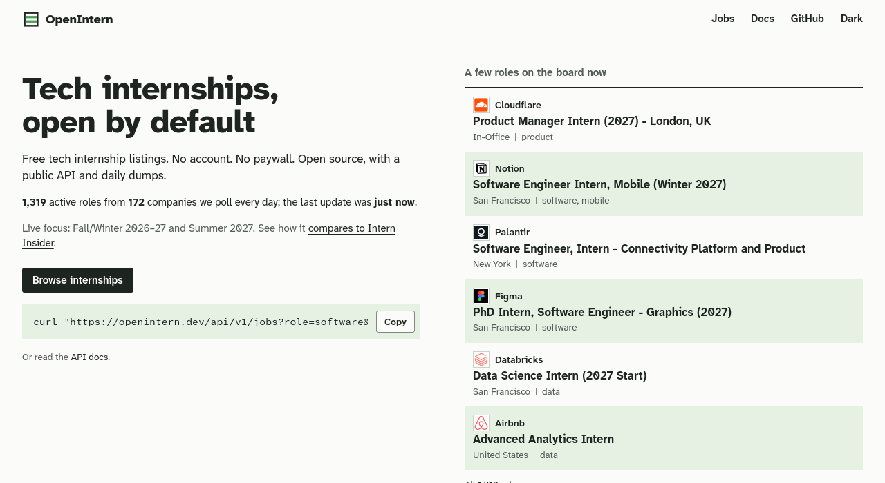

#  OpenIntern

A free, open board of tech internships, read every day from employers' public
job boards. No account, no paywall, a public API and daily dumps anyone can
reuse.



- Site: [openintern.dev](https://openintern.dev)
- API reference: [openintern.dev/docs](https://openintern.dev/docs)
- License: code Apache-2.0; for the listing data see [DATA.md](DATA.md)

## What it does

Once a day an ingest run reads public boards on **Greenhouse, Lever, Ashby,
Workable, SmartRecruiters, Recruitee, Rippling, BambooHR and Workday**, plus a
few employers' own careers sites (ByteDance/TikTok, AMD, Microsoft, Google,
IBM, Bloomberg, SIG, D.E. Shaw, Shopify). It keeps internship titles in tech
roles (software, data, ML, quant, hardware, product and more), works out
terms, durations and regions, and publishes the result as a dump. The site and
the API read that dump.

Every request identifies itself as OpenIntern; it never pretends to be a
browser. Tesla and Citadel refuse automated requests, so their public listing
pages are saved by hand ([data/manual](data/manual/README.md)). There is no
LinkedIn scraping and no recruiter-contact data.

The board keeps your "applied" marks in your own browser (`localStorage`).
Apply links always go straight to the employer. Company logos are copies
served from openintern.dev, so your browser never asks a company site or a
favicon service for anything ([data/logos](data/logos/README.md)).

## API and dumps

```bash
curl "https://openintern.dev/api/v1/jobs?role=software&region=canada&limit=10"
curl "https://openintern.dev/api/v1/jobs?season=fall,winter&duration_months=4,6"
curl "https://openintern.dev/api/v1/jobs/{id}"
curl "https://openintern.dev/api/v1/companies"
curl "https://openintern.dev/api/v1/health"
```

`/api/v1/jobs` takes `q`, `company` (slug), `role`, `region`
(`remote|us|canada|europe|other`), `season` (`summer|fall|winter`; `spring`
counts as summer), `duration_months` (overlap), `posted_after`, `page` and
`limit` (default 27, max 100). Results are grouped by role family
(`jobs[].postings[]`), and pages count families. The hosted API allows 60
requests a minute per IP.

For bulk use, take the daily dump instead of paging the API. It is flat, one
row per posting, at stable URLs:

- [jobs.json](https://github.com/dnexdev/openintern/releases/download/dump-latest/jobs.json)
  and [jobs.csv](https://github.com/dnexdev/openintern/releases/download/dump-latest/jobs.csv)
- `companies.json`, `health.json`, `denylist.json`, gzipped copies, and a
  sha256 `MANIFEST.json` with a build provenance attestation
  (`gh attestation verify jobs.json -R dnexdev/openintern`)
- dated `dump-YYYY-MM-DD` releases, kept for 30 days

Mirrors must drop the ids in `denylist.json`. Terms: [DATA.md](DATA.md).

## Run it locally

Go 1.26 or newer. The module uses the standard library only.

```bash
go run ./cmd/openintern serve -addr 127.0.0.1:3000   # reads the published dump
go run ./cmd/openintern serve -dump ./jobs.json      # or a local copy
go test ./...
```

`openintern help` lists every command. The ones you are likely to need:

| Command | What it does |
|---|---|
| `serve` | the website and API |
| `validate-companies`, `validate-curated` | check the registry files |
| `probe <url>` | find the ATS and token behind a careers or apply link |
| `validate-tokens`, `recover-tokens` | probe board tokens, guess fixes for broken ones |
| `logos` | fetch company logos into `data/logos` (commit the result) |
| `ingest <state-dir>`, `dump <state-dir> <out-dir>` | the daily pipeline, as the workflows run it |

## How it is put together

```
cmd/openintern     the one binary: every command above
internal/site      pages (html/template, embedded CSS/JS/fonts); look in DESIGN.md
internal/web       HTTP routes for the site and /api/v1
internal/board     reads the dump; filters, role families, pagination
internal/ats       one adapter per job board
internal/ingest    the daily run: fetch, classify, update state
internal/dump      writes and checks the public dump
internal/logos     fetches and re-encodes company logos
data/companies     the company registry (YAML, edited by pull request)
data/logos         committed company logos
api/index.go       the Vercel entry point
```

State is flat files (`companies.jsonl`, `jobs.jsonl`, `last_seen.tsv`,
`runs.jsonl`) in a separate state repository. The Ingest workflow updates it
at 12:00 UTC, the Dump workflow publishes the release, and Vercel serves the
Go handler in `api/index.go`. Runbooks and setup notes live in `docs/`.

`packages/` and a few `scripts/` helpers remain only as a parity reference
for Bend glue and golden regeneration. The Next.js frontend is gone; the
live site is Go ([docs/SETUP.md](docs/SETUP.md)).

## Add a company

Add an entry under `data/companies/` and open a pull request. See
[CONTRIBUTING.md](CONTRIBUTING.md) for board tokens per ATS. Include
`website_url` (the company's own site, not its job board): it is where its
logo comes from.

## Out of scope

LinkedIn scraping, contact or email finders, resume tools, browser automation,
accounts, and anything paywalled.
